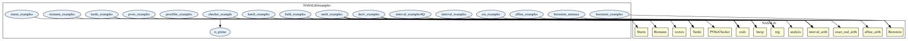
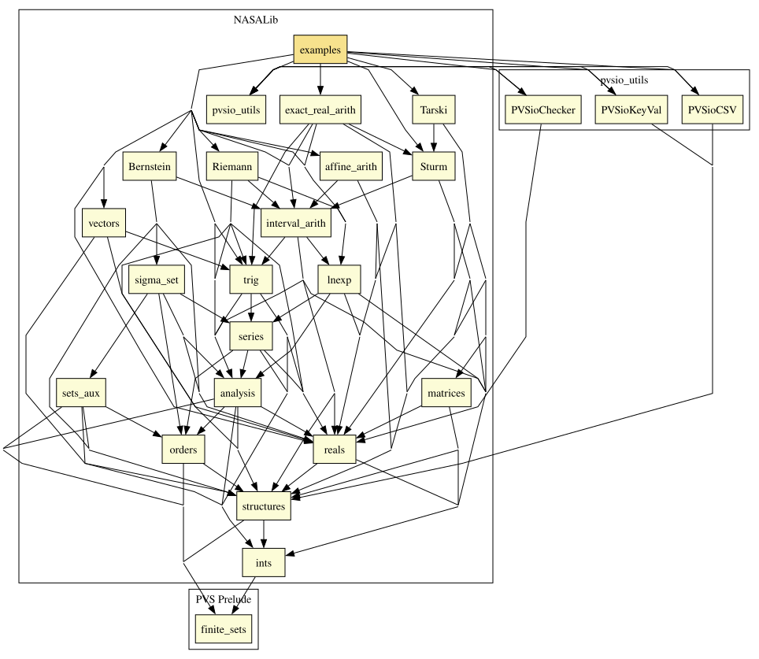

# Examples

Examples of application of the functionality provided by the NASALib, such as strategies and IO processing.

## Examples in other libraries

The examples of the following libraries are in the directory `examples` of each library. Each of these directories is a separate entry in `nasalib.all`.

| Library | Location | Theories |
| --- | --- | --- |
| analysis | [analysis/examples](../analysis/examples) | `deriv_examples` |
| interval_arith | [interval_arith/examples](../interval_arith/examples) | `interval_examples`, `interval_examples4Q` |
| affine_arith | [affine_arith/examples](../affine_arith/examples) | `affine_examples` |
| Bernstein | [Bernstein/examples](../Bernstein/examples) | `bernstein_examples`, `bernstein_minmax`, `bernstein_benchmarks` |
| Sturm | [Sturm/examples](../Sturm/examples) | `sturm_examples` |
| Tarski | [Tarski/examples](../Tarski/examples) | `tarski_examples`, `hutch_examples` |
| pvsio_utils | [pvsio_utils/pvsio_examples](../pvsio_utils/pvsio_examples) | `pvsio_examples`, `stdio_examples`, `csv_examples`, `kv_examples`, `primes`, `prime_factorization_checker` |
| exact_real_arith | [exact_real_arith/examples](../exact_real_arith/examples) | `era_examples` |
| Riemann | [Riemann/examples](../Riemann/examples) | `riemann_examples` |

The examples of the MetiTarski oracle are in the library itself, in [MetiTarski/metit_examples.pvs](../MetiTarski/metit_examples.pvs).

## Highlights

### Major theorems

| Theorem | Location | PVS Name | Contributors |
| --- | --- | --- | --- |

# Contributors
* [César Muñoz](http://shemesh.larc.nasa.gov/people/cam), NASA, USA
* [Sam Owre](http://www.csl.sri.com/users/owre), SRI, USA
* [Mariano Moscato](https://www.nianet.org/directory/research-staff/mariano-moscato/), NIA & NASA, USA

## Maintainer
* [César Muñoz](http://shemesh.larc.nasa.gov/people/cam), NASA, USA

# Dependencies

